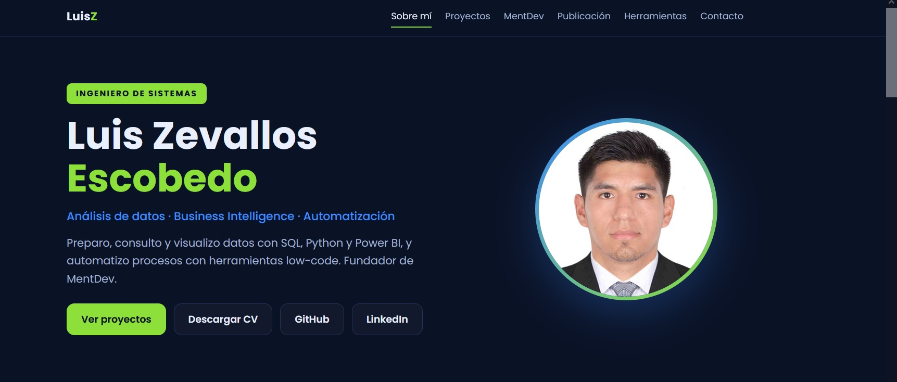

# Portafolio web · Luis Zevallos Escobedo

Sitio personal estático (HTML, CSS y JavaScript) alojado en **Amazon S3** con *static website hosting*. Es mi carta de presentación como Ingeniero de Sistemas orientado a datos y Business Intelligence, y reúne mis proyectos, MentDev y mi publicación en Springer.

**Sitio en vivo:** [luis-zevallos-ti.s3-website-us-east-1.amazonaws.com](http://luis-zevallos-ti.s3-website-us-east-1.amazonaws.com)

> El endpoint de sitio web de S3 funciona solo con HTTP. Más abajo explico cómo se puede pasar a HTTPS.



---

## Qué incluye

- Presentación, proyectos de datos con enlace a GitHub, emprendimiento MentDev, publicación científica y herramientas.
- Diseño responsive: se adapta a escritorio y celular.
- Sin librerías ni frameworks: HTML semántico, CSS propio y unas 20 líneas de JavaScript (año del pie de página y resaltado del menú).
- Accesibilidad básica: enlace para saltar al contenido, foco visible y respeto a `prefers-reduced-motion`.

## Arquitectura en AWS

Un solo servicio:

| Servicio | Para qué se usa |
|---|---|
| **Amazon S3** | Un bucket con alojamiento de sitio web estático que sirve `index.html` y sus archivos. |

No hay servidores, bases de datos ni otros servicios de AWS. La fuente (Poppins) se carga desde Google Fonts.

## Estructura del repositorio

```
├── index.html          Página única con todas las secciones
├── style.css           Estilos (tema oscuro con los colores de MentDev)
├── script.js           Año del pie y menú activo
├── images/             Foto de perfil, logo de MentDev, mascota Devi y favicon
├── docs/               Vista previa y CV en PDF
└── README.md
```

## Cómo reproducirlo en tu cuenta de AWS

1. **Crea un bucket de S3.** Elige una región y un nombre único. Este sitio usa `us-east-1`.
2. **Permite el acceso público de lectura.** En *Permisos*, desactiva "Bloquear todo el acceso público" y confirma la advertencia. Hazlo solo con un bucket que contenga contenido público.
3. **Activa el alojamiento de sitio web estático.** En *Propiedades*, abajo del todo, habilítalo y escribe `index.html` como documento de índice.
4. **Agrega una política de bucket** que permita leer los objetos. Reemplaza `NOMBRE-DEL-BUCKET`:

   ```json
   {
     "Version": "2012-10-17",
     "Statement": [
       {
         "Sid": "PublicReadGetObject",
         "Effect": "Allow",
         "Principal": "*",
         "Action": "s3:GetObject",
         "Resource": "arn:aws:s3:::NOMBRE-DEL-BUCKET/*"
       }
     ]
   }
   ```

5. **Sube los archivos** con el botón *Cargar*, manteniendo las carpetas `images/` y `docs/`.
6. **Abre el endpoint del sitio web** que aparece en *Propiedades > Alojamiento de sitios web estáticos*.

Los nombres de los menús pueden variar un poco según la versión de la consola.

### Para actualizar el sitio

Vuelve a cargar el archivo modificado, que sobrescribe al anterior. Si el navegador sigue mostrando la versión vieja, recarga sin caché con `Ctrl + F5`.

## Decisiones para no generar costos

- Sitio 100 % estático: sin servidores y sin servicios adicionales (sin CloudFront, sin dominio propio).
- Imágenes optimizadas en WebP: el sitio completo pesa menos de 1 MB.
- Sin dependencias de JavaScript: no hay nada que compilar ni mantener.
- Recomendación: antes de publicar, configura una alerta en **AWS Budgets** y revisa las condiciones vigentes del nivel gratuito de tu cuenta, porque cambian con el tiempo.

## Limitaciones y mejoras posibles

- **Solo HTTP.** El endpoint de sitio web de S3 no admite HTTPS. Para tenerlo habría que poner CloudFront delante con un certificado de ACM, algo que hoy no está implementado.
- **Sin dominio propio.** Se usa la dirección que entrega S3.
- **Contenido manual.** Cada cambio se sube a mano; se podría automatizar con GitHub Actions o con la AWS CLI.

## Créditos

Diseño y contenido: Luis Zevallos · MentDev.
Tipografía: [Poppins](https://fonts.google.com/specimen/Poppins) (Google Fonts).
